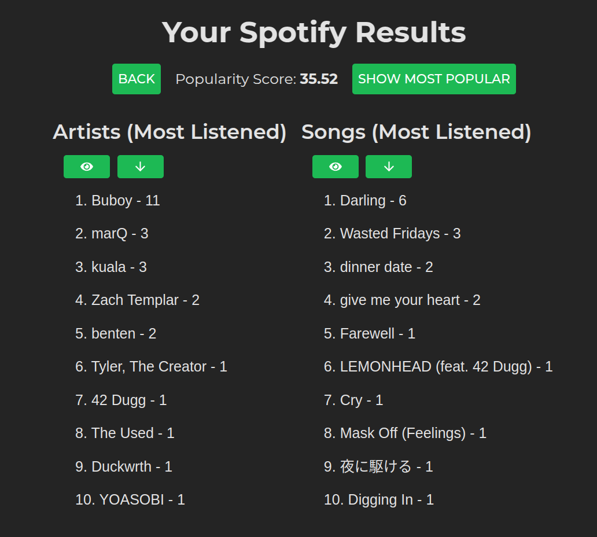

# NicheRank

NicheRank is a Spotify-authenticated app for scoring how niche or mainstream a listener's music taste is.

## Screenshots



## Tech Stack

- Frontend: React, TypeScript, Vite
- Backend: Flask, Python
- API: Spotify Web API
- Data: parsed Spotify Million Playlist Dataset
- Algorithms: custom playlist parsing, quicksort, mergesort, popularity scoring

## Features

- Spotify login and listening-history import.
- Top song and artist views.
- Popularity scoring against a larger playlist dataset.
- Dataset parsing and serialization utilities.
- Fake-user modes for testing scoring behavior without a live Spotify session.
- Custom sorting implementations for comparing listening history.

## Why I Built This

Spotify exposes a lot of personal listening data, but it does not directly answer whether a listener's taste is common or niche. This project explored that question by comparing user listening history against a larger playlist dataset and turning the result into a browsable score.

## My Role

I worked on the Flask API, Spotify integration, playlist parsing, scoring model, sorting algorithms, and frontend views for exploring a listener's results.

## Architecture

- `frontend` owns the React UI for login, score display, and song/artist exploration.
- `backend` owns Spotify authentication, user-history loading, scoring, and API responses.
- `playlist_parse.py` builds the comparison dataset used by the scoring model.
- `backend/algo_src` contains the parsing, sorting, user, and music comparison logic.

## Hard Parts

- Reducing a large playlist dataset into a form that could be compared quickly.
- Designing a score that was understandable without hiding the underlying song and artist data.
- Keeping fake-user and real Spotify flows useful for testing the app during development.

## What I Learned

- Data-heavy apps benefit from separating dataset generation from normal app startup.
- Sorting and parsing choices become visible quickly when the input dataset is large.
- OAuth projects need careful local setup instructions and credentials should stay out of the repo.

## Running Locally

Create a Spotify Developer app and configure its redirect URI for local development, for example `http://localhost:5000/callback`.

Backend:

```bash
git clone https://github.com/mattcattb/NicheRank.git
cd NicheRank/backend
pip install -r requirements.txt
python3 app.py
```

Frontend:

```bash
cd ../frontend
npm install
npm run dev
```

The Flask API runs on `http://127.0.0.1:5000`. The frontend runs through Vite.

## Dataset Notes

The project can use a prebuilt dataset or generate one from the Spotify Million Playlist Dataset. Dataset generation is intentionally separate from the normal app startup because parsing a large percentage of the source data takes time.

```bash
python3 playlist_parse.py --load_percent 0.3 --profile True
```

## Project Notes

This is an older data structures project, so some code is intentionally explicit to show the parsing, scoring, and sorting work. For public use, keep Spotify credentials in local environment files and do not commit them.
